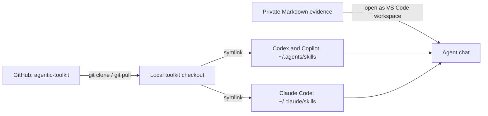

# Agentic Toolkit

A personal collection of reusable agent skills, plugins, and scripts for AI coding agents.

## Catalog

| Resource | Type | Purpose |
| --- | --- | --- |
| [Year-End Performance Review](skills/year-end-performance-review/SKILL.md) | Agent skill | Turns Markdown evidence (Git history, Jira tickets, appreciation emails, work notes) into an evidence-based year-end self-review with What and How bullets. |

## Repository structure

- `skills/<skill-name>/`: skills and their references, scripts, and metadata
- `plugins/<plugin-name>/`: plugins and their manifests
- `scripts/`: standalone and shared utilities
- [`AGENTS.md`](AGENTS.md): repository conventions

## Quick start: year-end performance review

This skill works with Codex, Claude Code, and GitHub Copilot in VS Code. Each tool looks for skills in a different folder, so the setup below links the skill into each location. If a tool doesn't pick it up, check its current documentation for the skill folder it uses.

### 1. Clone the toolkit

```bash
mkdir -p ~/Developer/Projects
cd ~/Developer/Projects
git clone https://github.com/swaraj89/agentic-toolkit.git
```

If you already cloned it, update instead:

```bash
git -C ~/Developer/Projects/agentic-toolkit pull --ff-only
```

### 2. Link the skill for each agent

Run this once. It skips any destination that already exists, so it never overwrites anything.

```bash
repo="$HOME/Developer/Projects/agentic-toolkit"
mkdir -p "$HOME/.agents/skills" "$HOME/.claude/skills"

for destination in "$HOME/.agents/skills" "$HOME/.claude/skills"; do
  link="$destination/year-end-performance-review"
  if [ -e "$link" ] || [ -L "$link" ]; then
    echo "Already exists, not changed: $link"
  else
    ln -s "$repo/skills/year-end-performance-review" "$link"
  fi
done
```

Claude Code reads `~/.claude/skills/`. Codex and GitHub Copilot read `~/.agents/skills/`. Because the links point to your checkout, `git pull --ff-only` updates the skill everywhere without copying it again.

### 3. Prepare your evidence

Keep your review files in a private folder outside this repository, for example:

```
performance-review/
├── commits.md
├── jira-tickets.md
└── appreciation.md
```

Some ways to create them:

- **Commits:** export your own commit history to Markdown:

  ```bash
  git log --author="Your Name" --since=2026-01-01 --until=2026-12-31 \
    --pretty=format:'- %ad %s' --date=short > commits.md
  ```

  Change the author and dates to match your review period.

- **Jira tickets and appreciation emails:** copy them into Markdown by hand. Include dates, ticket status, and who wrote the praise.

The skill can only read files in the folder you open, so open the folder that contains these files.

### 4. Start a chat and invoke the skill

Open File → Open Folder in VS Code, then open your agent's chat panel. For Codex, the sidebar is available from the Codex icon, or run **Codex: Open Codex Sidebar** from the Command Palette.

**Codex:**

```
Use $year-end-performance-review to write my year-end review from the Markdown files in this workspace.
```

**Claude Code, GitHub Copilot Chat:**

```
Use the year-end-performance-review skill to write my year-end review from the Markdown files in this workspace.
```

The skill asks one question at a time about your role, the review purpose and period, and what you want to highlight. It then returns plain-text What and How bullets and offers one revision round. If the skill doesn't appear, restart VS Code and start a new chat.

### 5. Update later

```bash
git -C ~/Developer/Projects/agentic-toolkit pull --ff-only
```

## Setup overview



## Privacy

This repository is public. Keep personal review evidence, credentials, generated output, and installed dependencies out of it. If you keep a private review folder inside a checkout, add it to `.gitignore`.

## About the review wording

The skill uses plain-language clarity guidance inspired by ASD-STE100 principles. It does not apply the full standard, does not include its controlled dictionary, and does not certify compliance. The project is not affiliated with or endorsed by ASD. See the [research notes](skills/year-end-performance-review/references/research-notes.md) for sources and limits.