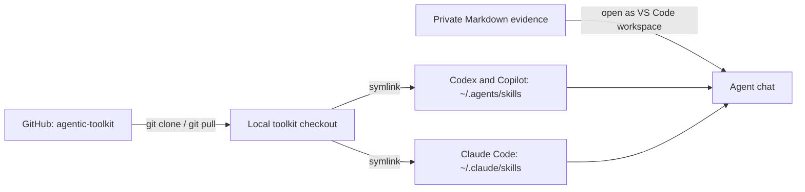

# Agentic Toolkit

A personal collection of reusable agent skills, plugins, and scripts.

## Catalog

| Resource | Type | Purpose |
| --- | --- | --- |
| [Year-End Performance Review](skills/year-end-performance-review/SKILL.md) | Agent skill | Turn Markdown evidence into a positive, evidence-based self-review with separate What and How bullets. |

## Repository structure

- `skills/<skill-name>/`: Skills and their references, scripts, and metadata.
- `plugins/<plugin-name>/`: Plugins and their manifests.
- `scripts/`: Standalone and shared utilities.
- [AGENTS.md](AGENTS.md): Repository conventions.

## Use the skill in VS Code

The skill works with **Codex**, **Claude Code**, and **GitHub Copilot** in VS Code. It reads Markdown evidence files in the workspace you open. The personal setup below keeps the toolkit checkout in one place and links the canonical skill into each agent's skill directory.

### 1. Clone the toolkit

Open VS Code, choose **Terminal → New Terminal**, then run:

```sh
mkdir -p ~/Developer/Projects
cd ~/Developer/Projects
git clone https://github.com/swaraj89/agentic-toolkit.git
```

If you have already cloned it, update it instead:

```sh
cd ~/Developer/Projects/agentic-toolkit
git pull --ff-only
```

### 2. Link the skill for each agent

Run this once in the terminal. It creates a link only when the destination does not already exist:

```sh
repo="$HOME/Developer/Projects/agentic-toolkit"
mkdir -p "$HOME/.agents/skills" "$HOME/.claude/skills"

for destination in "$HOME/.agents/skills" "$HOME/.claude/skills"; do
  link="$destination/year-end-performance-review"
  if [ -e "$link" ] || [ -L "$link" ]; then
    echo "Already exists: $link (check it before replacing it)"
  else
    ln -s "$repo/skills/year-end-performance-review" "$link"
  fi
done
```

Codex and GitHub Copilot can discover personal skills under `~/.agents/skills/`. Claude Code uses `~/.claude/skills/`. The link points to the toolkit checkout, so after `git pull --ff-only` the skill changes are available without copying the skill again. [Codex skill locations](https://learn.chatgpt.com/docs/build-skills) · [GitHub Copilot skill locations](https://docs.github.com/en/copilot/reference/customization-cheat-sheet) · [Claude Code skills](https://docs.anthropic.com/en/docs/claude-code/skills)

### 3. Open your review evidence

In VS Code, choose **File → Open Folder** and open the folder that contains your review Markdown files. Keep those files outside this public toolkit repository. For example:

```text
performance-review/
├── commits.md
├── jira-tickets.md
└── appreciation.md
```

The skill can only use files available to the agent in its current workspace. If the evidence is in a different folder, open that folder in VS Code or copy the relevant Markdown files into your private review folder.

### 4. Start a chat and invoke the skill

Open your agent's VS Code panel and start a chat. The Codex extension is available from the Codex icon; if needed, run **Codex: Open Codex Sidebar** from the Command Palette. [Codex IDE setup](https://learn.chatgpt.com/docs/codex/ide)

**Codex:**

```text
Use $year-end-performance-review to write my year-end review from the Markdown files in this workspace. Ask me one question at a time.
```

**Claude Code:**

```text
Use the year-end-performance-review skill to write my year-end review from the Markdown files in this workspace. Ask me one question at a time.
```

**GitHub Copilot Chat:**

```text
Use the year-end-performance-review skill to write my year-end review from the Markdown files in this workspace. Ask me one question at a time.
```

The skill asks about your role and expectations, the review purpose and period, and what you want to highlight. It reviews the evidence, asks targeted follow-up questions about impact, and returns plain-text What and How bullet lists. If the skill does not appear after setup, restart VS Code and start a new chat.

### 5. Pull updates later

The setup uses a symbolic link to the repository, so future updates only require:

```sh
cd ~/Developer/Projects/agentic-toolkit
git pull --ff-only
```

## Setup overview



## About the review wording

The skill adapts clarity principles from ASD-STE100 for performance reviews. It does not include the controlled dictionary or certify full compliance, and it is not affiliated with or endorsed by ASD. See the [research notes](skills/year-end-performance-review/references/research-notes.md).

Keep personal review evidence, credentials, generated output, and installed dependencies outside this public repository.
